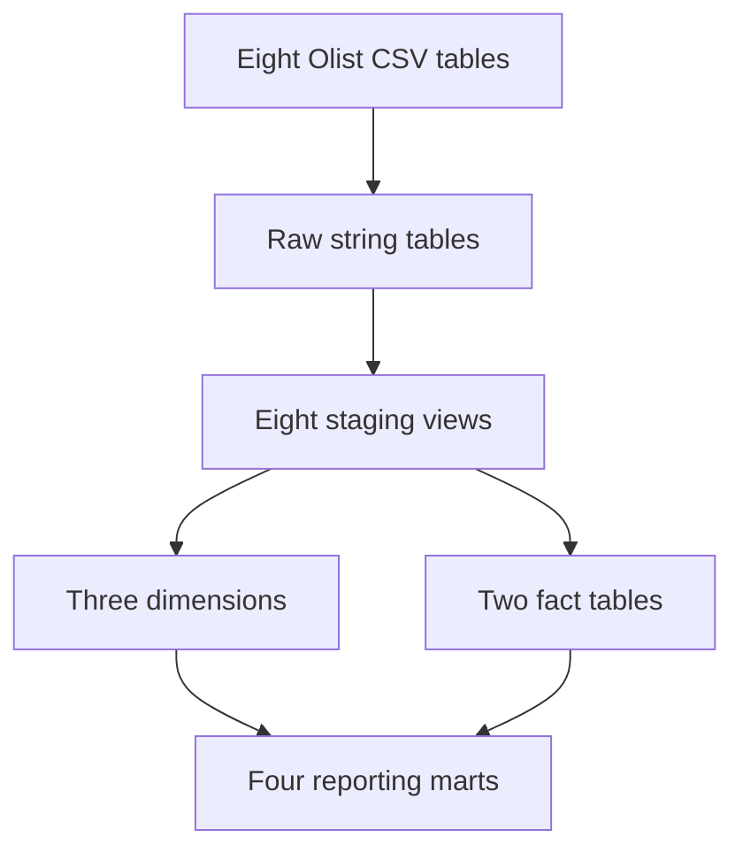

# Architecture and model contracts

Airflow runs `load_raw → dbt_build → reconcile` serially. `dbt build` resolves SQL dependencies via `ref()`, creates upstream models first and runs their tests. Failed upstream tests prevent dependent models being built. Only one DAG run can write the warehouse at a time. This is a full-snapshot batch workflow, with no incremental DML, CDC, streaming or SCD history.

## Grain and dependencies

| Model | One row per | Direct dependencies |
|---|---|---|
| `stg_orders` | order | raw orders |
| `stg_items` | order/item number | raw items |
| `stg_customers` | order-linked customer ID | raw customers |
| `stg_sellers` | seller ID | raw sellers |
| `stg_products` | product ID | raw products |
| `stg_categories` | Portuguese category | raw category translation |
| `stg_payments` | order/payment sequence | raw payments |
| `stg_reviews` | review record, not unique order/review ID | raw reviews |
| `dim_customers` | customer ID | `stg_customers` |
| `dim_sellers` | seller ID | `stg_sellers` |
| `dim_products` | product ID | `stg_products`, `stg_categories` |
| `fct_order_items` | `(order_id, order_item_id)` | `stg_items` |
| `fct_orders` | order ID | `stg_orders`, `fct_order_items`, `stg_payments`, `stg_reviews` |
| `mart_monthly_revenue` | purchase month | `fct_orders` |
| `mart_fulfilment` | order status | `fct_orders` |
| `mart_delivery` | delivery band | `fct_orders` |
| `mart_category_freight` | English/fallback category | `fct_order_items`, `dim_products` |

## Relationships

`fct_orders.customer_id → dim_customers.customer_id` is many-to-one. `customer_unique_id` identifies repeat people but is not the dimension's primary key: the source's `customer_id` is order-linked. `fct_order_items.order_id → fct_orders.order_id`, `.product_id → dim_products.product_id` and `.seller_id → dim_sellers.seller_id` are many-to-one. Natural source keys are sufficient for this static snapshot; surrogate keys would not add history or integration value here.

An order can have several items, payment records and reviews. Each child table is aggregated to one row per order before it joins `fct_orders`, preventing fan-out. `avg_review_score` averages all source review records for each order; the delivery mart then averages those order averages, weighting each reviewed order equally. Review text and names/addresses are not selected into staging.

Missing payments/reviews remain null rather than implying zero payment or a zero-star review. Orders without items retain a zero merchandise amount and item count. Unknown categories fall back to the Portuguese name, then `unknown`. Dimensions preserve their static source attributes.

## Metric definitions

- `merchandise_value`: sum of item prices; all statuses retained. Delivered merchandise includes only `order_status = 'delivered'`.
- `payment_value`: sum of recorded payment rows; not forced to equal item price plus freight. These represent different source concepts and some records differ.
- Delivery: compare calendar dates; the estimated date is inclusive. `delivery_days` and `delay_days` count calendar-day boundaries, not elapsed 24-hour periods. Both dates are required for observed delivery bands. No timezone conversion is inferred from naive source timestamps.
- Freight burden: `freight_value / (price + freight_value)` per item, null when denominator is zero; high freight means strictly greater than 0.30.
- Monthly reporting uses purchase month, including unresolved/canceled orders; it does not imply settlement month.

Staging is materialized as views; facts, dimensions and marts are rebuilt tables. `macros/types.sql` isolates DuckDB/BigQuery differences for money types, date differences and month truncation. BigQuery execution remains unverified.
